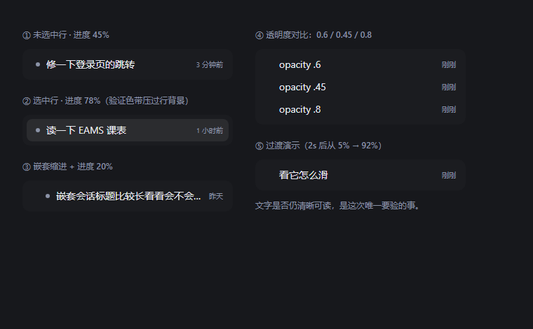
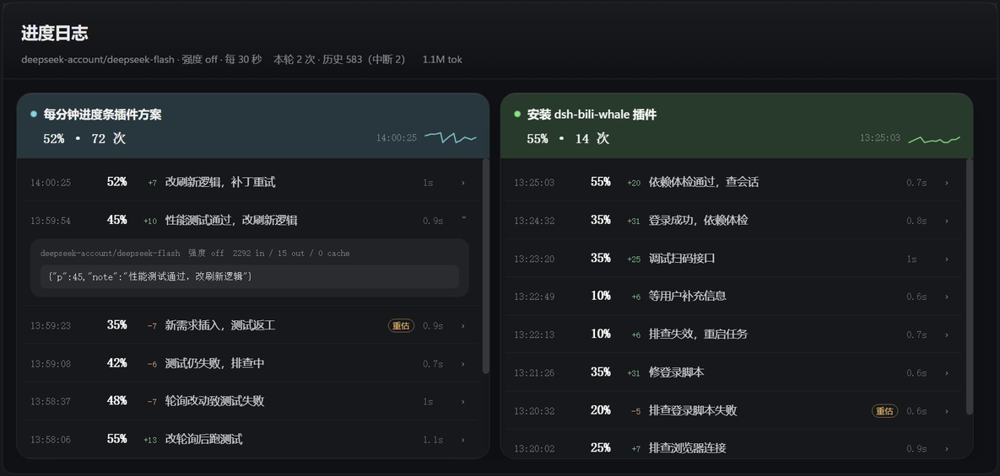

<sub>大鲸鱼在线写插件</sub>

# dsh-session-progress

> 你是不是还在为了不知道大肥鱼在吃多少白饭，到底干活干到哪了而烦恼？别担心！让我来助你！全新进度条让你实时了解大鲸鱼在干嘛！将进度条接入大模型注入上下文，让鲸鱼去监督鲸鱼！可选监督大模型、可调思考强度、可变进度条颜色、可变进度条样式，懂鱼更懂你！


## 它解决什么

AI 干活最难受的地方不是慢，是**不知道它在哪**。一轮跑了二十分钟，你只能盯着最后一个工具调用猜：是卡住了，是在跑测试，还是已经快好了？

这个插件把答案变成**一行像素**。

- **一眼可扫**：侧栏每条会话行底下铺一条半透明色带，扫一眼就知道走到哪了，不用点进去翻日志。
- **让鲸鱼监督鲸鱼**：真正干活的模型没空汇报，就派一个最便宜的小模型读它的上下文、替它说"现在到 60%"。不打断主流程，不占主模型预算。
- **旁路观察**：不加工具、不插 DOM、不改对话——色带是 `::after` 伪元素，标题、时间、悬停按钮全部照常可读可点。判断模型自己花了多少 token 也一并记账。
- **可调**：监督用哪个模型、思考强度多少、色带什么颜色、什么样式，都在设置里改，改完立刻能看到预览。
- **经得起换机**：写死的只是"优先用哪个模型"，别人机器上没有就自动挑一个可用的。
- **不会卡住**：日志轮询带 8 秒超时和看门狗，一次请求没回来就重新发，面板头部还有手动「刷新」；会话被关掉但没走到 `turn/end` 时，宿主按「中断」把它收进历史，不留一列永远不动的幽灵进度。

代价也说清楚：每个正在跑的会话每 30 秒一次真实模型调用（约 1–2k 输入 token），默认最多 3 个会话。不想花就说 `enabled: false`。

## 长什么样

在 [DeepSeek Harness](https://github.com/deepseek-ai/deepseek-harness)（DSH）侧栏的每一个会话行上，铺一条**从行左向右伸长的半透明进度色带**：每 30 秒让一个**最轻思考强度**的模型读一遍当前轮次的上下文，给出 0–100 的进度，CSS 自己把色带平滑地推到那个位置。

- 颜色 `#90AFFF`，不透明度 60%，`0.9s` 缓动 —— 每轮一次采样，色带就往前跳一步。
- 色带是**铺在整行底下**的：标题、时间、悬停按钮全部照常可读可点，不插入任何 DOM。
- 进度**由判断模型自己定方向**：上一次的数字与阶段名会一起交给它，卡住或返工时它会主动下调；宿主只封顶 95，一轮结束（`turn/end`）补满 100，停留一瞬再淡出。
- 色带里有一道**一直在走的高光**：判断模型半分钟才给一次新数字，中间这段时间它让人知道「还在动」。它是一条平铺的斜纹，用 `background-position` 每 10.5 秒平移一个周期（默认「慢」档），所以**任何时候都有至少一道在带子里**，不会出现"走完一趟空半天"。一个周期 200px、其中只有约 20px 是高光本体，两道之间隔得远，看起来是"偶尔走过来一次"而不是一直在闪。一个周期 264px，一层薄纹 132px、一层宽纹 264px，共用一次 268.073px 的位移，所以首尾同相、任何宽度都接得上。开关、速度（慢 / 标准 / 快）、质感（实验折射 / 高级 / 中等 / 低 / 关）都在设置里；系统开了「减少动态效果」（`prefers-reduced-motion`）时自动关掉。
- 左侧栏多一个「**进度日志**」，把判断模型的每一次采样列出来，**一个会话一列、从左到右并排**：列头是色点、会话标题、最新进度和采样次数，列内各自滚动。每条采样只占**一行**（时间 / 进度 / 涨跌 / 阶段名 / 耗时），点一下才展开模型、档位、token 拆分和 JSON 原文。
- **换一台机器不用改配置**：写死的只是「优先用哪个模型」，本机没有就自动挑一个可用的（详见[换机器](#换一台机器--别的-provider)）。
- **轮次有始有终**：「进度日志」最左边是**历史轮**栏，一轮跑完（`完成`）或被停掉（`中断`）都会收进去，默认显示最近两条，点「展开全部」看全部；每个会话的每一轮单独成块，颜色点跟着会话走。
- **断了能接上**：被打断的轮次会记下当时到几成；下次同一会话开跑，色带**从那个数字继续**，而不是退回 0。走的时候宿主的判断模型也会被告知「上一轮被打断，已到 X%」，免得它把接续的活当成新活估成个位数。日志写在 `~/.dsh/session-progress.log.json`，DSH 重启后历史还在。
- **闲着几乎不花钱**：没人动的时候不重发帧、不重写样式、不重拉日志（服务端按版本号回一行「没变」），标签页隐藏时连轮询都停；实测空转流量从 8.7 KB/s 降到 0.4 KB/s。





## 安装

```sh
dsh plugin --profile desktop add github:Yu-jianhai/dsh-session-progress
```

然后**完全退出 DSH 再重新打开**。

想锁定版本，就在后面跟 commit：

```sh
dsh plugin --profile desktop add github:Yu-jianhai/dsh-session-progress#<commit-sha>
```

本包是纯 JavaScript、`lib/` 已提交，**没有构建步骤**，所以不需要给 pnpm 授权运行 `prepare`。卸载：

```sh
dsh plugin --profile desktop remove dsh-session-progress
```

## 用起来是什么样

| 位置 | 内容 |
|---|---|
| 侧栏会话行 | 整行宽的色带（默认 `#90AFFF`、60% 不透明），宽度 = 当前进度；颜色、不透明度、样式都能在设置里改 |
| 设置 → 插件 → 会话进度条 | 模型 / 思考强度 / 采样间隔 / 并发上限 的可视化表单，配置落在 `~/.dsh/session-progress.config.json` |
| 左侧栏「进度日志」 | 判断模型的每一次采样：**每个会话一列，从左到右并排**（列头 = 色点 + 会话标题 + 最新进度 + 次数）；每条一行 = 时间 + 进度 + 涨跌 + 阶段名 + 耗时，点开才看模型、档位、token 与 JSON 原文 |
| 设置页里的同名卡片 | 与上一条同一份数据，不离开设置也能看 |

顶栏统计里有一行**累计消耗的 token**（判断模型自己的开销，不含你的主对话）：也就是每一次采样 `usage` 的 `inputTokens + outputTokens + cacheReadTokens + cacheWriteTokens` 之和，每条记录里也单独标了这一次用了多少。列的顺序按"最近一次采样"排，某列跳到前面时会有 420ms 的滑动过渡，不会突然闪过去（`prefers-reduced-motion` 下不播放）。

进度语义（`lib/index.js`）：

1. 用户发来新消息 → 该会话开始采样，色带从 `seedP`（默认 4%）起步，先给一点反馈；
2. 每 `intervalMs` 采一次。提示里会带上**你上一次给的数字和当时它自己写的阶段名**（例如「当前进度：45%（当时阶段是「改接口」）」），然后请它对照这段时间的记录判断：又推进了多少、有没有停滞或返工、上次是不是估高了。
   **方向由它自己定**——宿主直接把它的数字画上去，下跌也一样；宿主只保留上界 95（100 留给收尾）。日志里每条会显示 `+5` / `-3` 的小标记，要准确数字可以看左侧栏的列头；
   例外是**插嘴**：你在一轮还没跑完时又发了消息，剩余工作量已经变了，于是 `interjectDelayMs`（默认 2.5s）后再采一次，并额外告诉模型"目标变了，请按新要求重估"。日志里那一条会挂一个橙色的「重估」标记；
3. `turn/end`（任何结束原因）→ 立刻置 100，`700ms` 后开始淡出，`420ms` 后整条移除；
4. 采样失败 → 保留上一次的值；色带只在会话真正在跑时存在。

## 配置

配置文件：`~/.dsh/session-progress.config.json`（UI 保存的覆盖值，优先于 `cordis.patch.yml`）。

| 键 | 默认 | 范围 | 说明 |
|---|---|---|---|
| `enabled` | `true` | — | 总开关 |
| `provider` | `deepseek-account` | — | 模型提供方 |
| `model` | `deepseek-flash` | — | 判断用的模型 |
| `reasoningEffort` | `off` | — | 思考强度；模型不提供该档位时**按档位距离取最近的一档**并打印日志 |
| `intervalMs` | `30000` | 5000–3600000 | 采样间隔 |
| `interjectDelayMs` | `2500` | 500–30000 | 插嘴后多久补采一次（附带「目标变了」的提示） |
| `firstDelayMs` | `8000` | 0–3600000 | 本轮首次采样前的等待，让模型先做点事 |
| `maxSessions` | `3` | 1–10 | 同时采样的会话数上限 |
| `maxContextChars` | `6000` | — | 送进模型的上下文上限（超出截尾） |
| `timeoutMs` | `30000` | — | 单次采样超时 |
| `seedP` | `4` | — | 首次采样返回前的起步宽度 |
| `color` | `#90AFFF` | `#RRGGBB` | 色带颜色；非十六进制值会被忽略并保留旧值 |
| `opacity` | `0.6` | 0.05–1 | 色带不透明度 |
| `style` | `band` | 六种之一 | 色带形状，见下节 |
| `flow` | `true` | 布尔 | 色带里那道流动的高光开不开 |
| `flowSpeed` | `slow` | `slow` / `normal` / `fast` | 高光走一圈的时间：慢 10.5s、标准 5.9s、快 3s |
| `flowQuality` | `medium` | `refract` 实验 · 折射 | 表面整层盖到**文字上方**，用 `backdrop-filter` 把底下的字和背景一起扭一下（隔着水看东西的形变），自己那道光也在抖 | 唯一会"扭到内容"的一档，也最费 GPU（每帧一次 backdrop 位移）；卡就往 `medium` 退 |

**思考强度以模型目录为准。** 设置页的下拉框、采样时传给 adapter 的值、以及启动时打印的 `offered: …` 都来自同一份 `listModels()` 目录；`resolveModelInfo()` 与它不一致时以目录为准（`deepseek-flash` 的目录里就有 `off`）。

## 外观

设置页里「进度条颜色」「不透明度」「进度条样式」「流动动画」「动画速率」「动画质量」六个选项改完点保存即可，下方还有一行**用当前数值真画出来的预览**，拖颜色/不透明度时侧栏的色带会实时跟着变。

设置页里的「进度日志」只是一个入口（按钮会打开侧栏那块面板），**日志本身不在这里重复一遍** —— 一份数据两个界面，迟早会两边不一样。

预览是**实时**的：颜色、不透明度、样式、动画质量/速率、开关，改哪个预览立刻跟着变（这一版修的就是它 —— 之前改动画那三项要等下一次保存才生效）。预览也是**临时**的：改完不保存，离开设置页或点「重置」就还原成已保存的值。宿主每 2 秒会把自己保存的样式广播一次，插件把"未保存的预览"和"已保存的值"分开记，预览期间广播不会把色带顶回去。

六种样式（`style` 取值）：

| 值 | 样子 | 什么时候用 |
|---|---|---|
| `band` | 渐变横幅，右端 10px 渐隐 | 默认。最像"进度条"，高对比但不抢标题 |
| `solid` | 纯色实条，右端 1px 亮边 | 最克制；侧栏窄、颜色又淡时比 `band` 更清楚 |
| `underline` | 3px 细线贴行底 | 不想压住标题和时间的读法，信息密集时首选 |
| `stripe` | 45° 斜纹叠在底色上 | 进度变化慢、但希望"在跑"这件事一直显眼 |
| `glow` | 左淡右亮 + 内侧亮边 + 柔光 | 视觉最重，适合只在少数会话上开 |
| `segments` | 按 20% 切格 | 想一眼看出"到第几格"，比连续条更容易估读数 |

颜色要写成 `#RRGGBB`。非法的颜色/样式不会被写进配置，也不会拼进样式表（`test/look.mjs` 就是锁这件事的）。想先肉眼挑样式，打开 `dev/styles.html`（由 `node dev/gen-styles.mjs` 从真实源码生成，六种样式 × 三种进度 × 三种不透明度 × 三种颜色）。

### 流动高光的质感

高光本身是一条斜纹，质感靠"让它脚下的画面真的动起来"来做：

| 值 | 效果 | 代价 |
|---|---|---|
| `refract` 实验 · 折射 | 表面整层盖到**文字上方**：自己带水波位移，再用 `backdrop-filter` 把下面的字和背景一起扭一下，叠一层红蓝色散（左缘泛品红、右缘泛青白），再铺一层很淡的底色保证字还看得清 | 唯一会"扭到内容"的一档，也最费 GPU（每帧一次 backdrop 位移）；卡就往 `medium` 退 |
| `high` 高级 | 水波扭曲 + 光学折射：`feTurbulence` + `feDisplacementMap` 让高光边缘随水波摆动，再叠一层 `backdrop-filter` 把底下的颜色轻微晕开、提亮 | 每个正在跑的会话行各多一层滤镜，GPU 吃得最多 |
| `medium` 中等（默认） | 只有水波扭曲，高光边缘会像水面裂纹那样左右摆；不做背景模糊 | 中等 |
| `low` 低 | 扁平高光，宽度和形状都不变（0.10 及以前的样子） | 几乎为零 |
| `off` 关 | 完全没有高光 | 零 |

滤镜是一个**挂在 `<body>` 里的 `<svg>`**，由插件在启动时创建、卸载时删掉；规则里只是 `filter: url(#dsp-water)` / `url(#dsp-refract)` 引用它。所以这套效果不依赖任何外部资源，也不需要联网。造不出滤镜时（极少数壳子没有 `createElementNS`）会静默退回纯色高光，不会把整条色带弄没。

滤镜造不出来时（浏览器太老、DOM 被裁过），插件会**静默退回纯色高光**而不是让色带消失——引用一个不存在的 `filter: url(#…)` 会让整个元素都不绘制，这是必须挡住的一种失败。

想先看五种质感的差别，打开 `dev/water.html`（`node dev/gen-water.mjs` 生成）：上面一行是 4 个行宽的等比例并排，下面一行放大 2.6 倍，底下的说明里写着每种质量的 `filter` / `backdrop-filter` 实际取值。

## 换一台机器 / 别的 provider

`provider` / `model` 的默认值（`deepseek-account/deepseek-flash`）只是一份**偏好**，不是硬依赖。宿主第一次能读到模型目录时会核对：

1. 配置的模型存在 → 直接用；
2. 不存在 → 按名字挑一个便宜的顶上（`mini`/`lite`/`small`/`nano`/`haiku` 优先，其次 `flash`/`fast`/`instant`，最后 `turbo`，都没有就取目录第一个），并把实际生效的路线写进 `/config` 的 `effectiveRoute`，设置页会显示一行提示「原配置的模型在本机不存在，已自动改用 X」；
3. 目录是空的（这台机器还没配任何 provider）→ **不调用模型**，`/config` 返回 `catalogEmpty: true`，界面上直接告诉你「先去配置一个 provider」，避免刷一屏失败日志。

`cordis.patch.yml` 里因此**不写死 provider/model**：别人 clone 下来装上，第一次运行就知道该用什么。想锁定，就在设置卡片里选一次，值会落到本机的 `~/.dsh/session-progress.config.json`。

## 原理（为什么不用 React 组件）

DSH 给每个会话行渲染了稳定属性 `data-row-key="session:<id>"`，但**没有**一个常显的行内插槽：running 时 `sidebar.session.row.leading` 被状态点占着，行尾按钮只在悬停时出现。所以本插件一点 DOM 都不往行里插，只做两件事：

1. 注入一张固定样式表：给行加 `position: relative; isolation: isolate`，用 `::after` 画色带，宽度取 `--dsp-p`、不透明度取 `--dsp-o`，`z-index: -1` 让它待在行背景之上、文字之下；
2. 每次进度变化时整体重写另一张很小的样式表，按 id 写入 `[data-row-key="session:<id>"]{--dsp-p:42%;--dsp-o:.6}`。

`--dsp-p` 用 `@property` 注册为 `<percentage>`，于是「改变量」就等于「CSS 原生过渡」，完全不需要 React 重绘，也不受会话行重渲染影响。（`inherits` 必须是 `true`：变量写在行上、由伪元素读取，否则伪元素拿到的是初始值 `0%`。）

运行态判定用三个宿主信号，不轮询：

```js
ctx.on('session/event',      (session, event) => event.type === 'turn/start' ? run() : event.type === 'turn/end' ? idle() : null)
ctx.on('api-session/status', (sessionId, running) => …)
ctx.on('agent/status',       ({ agent, status }) => …)
```

### 端点（只监听回环地址）

| 路径 | 用途 |
|---|---|
| `/plugins/dsh-session-progress/events` | SSE，首帧为全量快照，之后每次变化一帧 |
| `/plugins/dsh-session-progress/snapshot` | 一次性 JSON 快照 |
| `/plugins/dsh-session-progress/log` | 判断模型的采样历史（环形缓冲，最多 300 条） |
| `/plugins/dsh-session-progress/config` | 读 / 写配置 |
| `/plugins/dsh-session-progress/debug` | 运行态、采样器、实际档位、模型目录 |

这些端点拒绝非本机 `Host` 的请求（`isLocalRequest`），不会对外网暴露。

## 已知取舍

- **依赖 `data-row-key` 这个内部属性。** 宿主改渲染方式时，色带会静默消失 —— 不崩溃、不错位、不污染别人的界面。
- **日志里的列头是会话名，不是 id。** 取值顺序：`session/title` 事件的标题 → 该会话的第一条用户消息（截 40 字）→ 短 id。刚建的新会话在自动命名之前，会先用你发的那句话当名字，所以任何时候都不该只看到一串代号。
- **自动换模型只看名字。** 名字里没有任何便宜档线索时，取目录里的第一个模型 —— 可能是贵的那一个；设置页里改一次即可锁定。
- **拖拽排序时会闪一下。** 宿主用 `::before` / `::after` 画插入指示线，与我们的伪元素撞车一瞬。
- **颜色是字面色，不走主题 token。** `#90AFFF` 是需求指定的值，暗色主题下偏亮；只把下拉菜单等原生控件交给 `--dsw-alias-*`。
- **会真的花 token。** 每个正在跑的会话每 30 秒一次真实模型调用（约 1–2k 输入 token），默认最多 3 个会话；把 `intervalMs` 调大或 `enabled: false` 可以随时停。
- 采样不并发：同一会话上一轮没回来就跳过这一拍。

## 开发

```sh
node scripts/snapshot.cjs pre-<你要干什么>   # 开工先拍快照，崩了一键回滚
npm test                                     # 十套
npm run check
```

- **改代码前先读 [`AGENTS.md`](AGENTS.md)**（60 秒开工流程）和 [`ARCHITECTURE.md`](ARCHITECTURE.md)（符号索引），**报错先查 [`PROBLEMS.md`](PROBLEMS.md)**（15 条真炸过的坑，现象→原因→修法→哪条测试守着）。
- `node scripts/snapshot.cjs <label>` 把源码、测试、探针页、文档打包到 `backups/`（不进 git，含 git rev 与逐文件 sha256）；`node scripts/restore.cjs latest`（或快照名）原地恢复，并删掉快照之后新增的散文件。

- `test/host-smoke.mjs`：宿主半侧冒烟测试，用临时 state 文件，不碰你真实的 `~/.dsh/*.json`。
- `test/direction.mjs`：`nextProgress` 的方向规则——上下都照单全收、封顶 95、解析失败保留原值。
- `test/client-boot.mjs`：用桩 DOM 把浏览器半侧整个启动起来，喂真实 SSE 帧，断言样式表真的被写出来、清理真的收干净。纯函数测试看不到这类错误——`render()` 里一个未定义的标识符会让色带**整条消失**而控制台只有一行 `bad frame`。
- `test/route-fallback.mjs`：模拟**别人的机器**——目录里没有默认模型时自动改用一个便宜模型、目录为空时一次模型都不调。
- `test/render.mjs`：四个 slot（`main` / `sidebar.panellist` / `plugins.bundle.config` / `settings.plugins.tab`）用空 payload 和满 payload 各渲染一次。0.11.2 那次白屏就是 `data.active` 空指针——`Number(null) === 0` 骗过了守卫，只有真渲染才发现。
- `test/perf-contract.mjs`：空转成本的三条线（增量 `/log`、SSE 去重、落盘瘦身）与客户端自报版本。
- `dev/release.cjs`：发布用，「大鲸鱼在线写插件」那句话由它自动加到 Release 正文开头，别再手拼 `curl`。
- `dev/harness.html`：把宿主真实的行结构与内联 CSS 复刻成独立页面，用来在没有 DSH 的情况下比对色带宽度、透明度与缓动。
- `dev/select-theme.html` / `dev/theme-probe.html`：验证原生 `<select>` 在深色主题下的弹层配色，以及主题判定函数在五种信号下的结果。
- 浏览器侧没有 JSX、没有构建：`lib/client.js` 是 `window.__ModuleLoader__.load({ id, factory })` 形式，React 由 `require('react')` 取得。

## License

[MIT](LICENSE) © 2026 Ne_Rn
